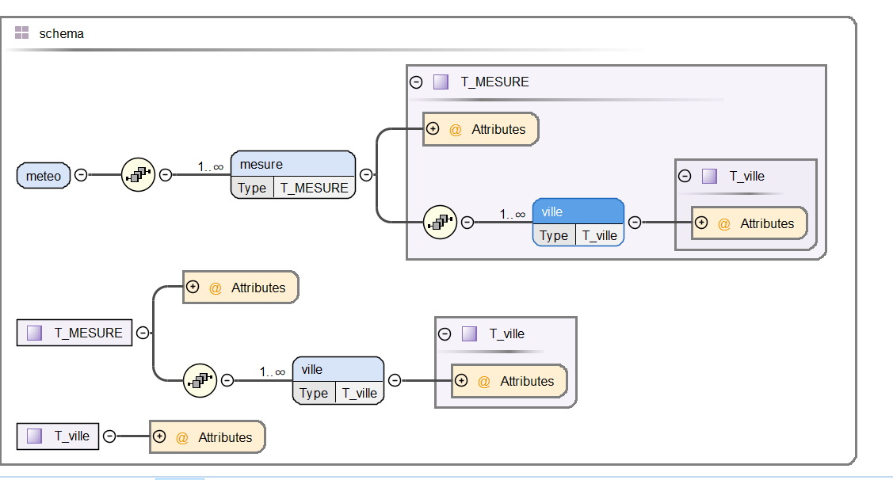
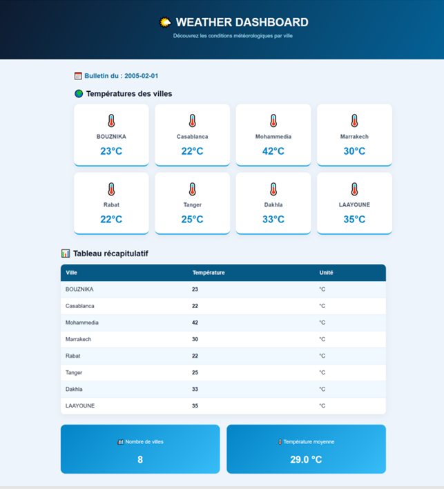
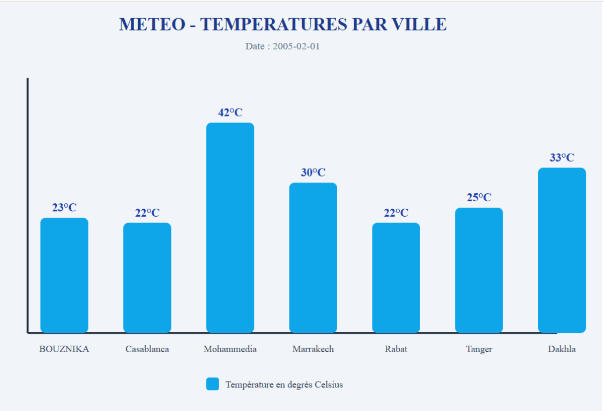

# Projet Meteo - XML, DTD, XSD et XSLT

Ce projet presente des releves meteorologiques pour plusieurs villes. Il illustre :

- la validation XML avec DTD ;
- la validation XML avec XML Schema (XSD) ;
- la transformation XML vers HTML avec XSLT ;
- la generation d'un graphique SVG avec XSLT.

## Apercu

### Schema XML



### Tableau de bord HTML



### Graphique SVG



## Structure du projet

| Fichier | Role |
|---|---|
| `meteo.xml` | Document XML valide avec une DTD |
| `meteo.dtd` | Declaration DTD |
| `tp.xml` | Deuxieme document XML avec une DTD |
| `tp.dtd` | DTD du document `tp.xml` |
| `meteo.xsd` | Schema XML definissant la structure de `meteo.xml` |
| `tp.xsd` | Schema XML definissant la structure de `tp.xml` |
| `meteo.xsl` | Transformation vers un tableau de bord HTML |
| `meteo2.xsl` | Transformation vers un graphique SVG |
| `meteo2.xml` | XML associe a son XSD et a la feuille XSLT SVG |
| `m1.html` | Page HTML generee a partir de `meteo.xsl` |
| `m1.svg` | Graphique SVG genere a partir de `meteo2.xsl` |
| `m2.html` / `m2.svg` | Anciennes versions generees |

## Structure XML

```xml
<meteo>
    <mesure date="2005-02-01">
        <ville nom="BOUZNIKA" temperature="23"/>
        <ville nom="Casablanca" temperature="22"/>
    </mesure>
</meteo>
```

La racine est `meteo`. Elle contient une ou plusieurs mesures. Chaque mesure possede une date obligatoire et une ou plusieurs villes.

## DTD

```dtd
<!ELEMENT meteo (mesure+)>
<!ELEMENT mesure (ville+)>
<!ELEMENT ville EMPTY>

<!ATTLIST mesure
    date CDATA #REQUIRED
>

<!ATTLIST ville
    nom CDATA #REQUIRED
    temperature CDATA #REQUIRED
>
```

Le document XML declare sa DTD ainsi :

```xml
<?xml version="1.0" encoding="UTF-8"?>
<!DOCTYPE meteo SYSTEM "meteo.dtd">
```

## XML Schema (XSD)

```xml
<xsd:schema xmlns:xsd="http://www.w3.org/2001/XMLSchema">
    <xsd:element name="meteo">
        <xsd:complexType>
            <xsd:sequence>
                <xsd:element name="mesure"
                             maxOccurs="unbounded"
                             type="T_MESURE"/>
            </xsd:sequence>
        </xsd:complexType>
    </xsd:element>

    <xsd:complexType name="T_MESURE">
        <xsd:sequence>
            <xsd:element name="ville"
                         maxOccurs="unbounded"
                         type="T_ville"/>
        </xsd:sequence>
        <xsd:attribute name="date" type="xsd:date" use="required"/>
    </xsd:complexType>

    <xsd:complexType name="T_ville">
        <xsd:attribute name="nom" type="xsd:string" use="required"/>
        <xsd:attribute name="temperature" type="xsd:double" use="required"/>
    </xsd:complexType>
</xsd:schema>
```

Pour associer le document au schema :

```xml
<meteo xmlns:xsi="http://www.w3.org/2001/XMLSchema-instance"
       xsi:noNamespaceSchemaLocation="meteo.xsd">
    <!-- mesures -->
</meteo>
```

## Transformation HTML

Dans `meteo.xsl`, le tableau de bord est genere avec une boucle XSLT :

```xml
<xsl:for-each select="meteo/mesure[@date='2005-02-01']/ville">
    <div class="city-card">
        <h3>
            <xsl:value-of select="@nom"/>
        </h3>
        <div class="temperature">
            <xsl:value-of select="@temperature"/>°C
        </div>
    </div>
</xsl:for-each>
```

La moyenne des temperatures est calculee ainsi :

```xml
<xsl:value-of
    select="format-number(
        avg(ville/@temperature ! xs:decimal(.)),
        '0.0'
    )"/> °C
```

## Transformation SVG

Dans `meteo2.xsl`, les villes du bulletin `2005-02-01` sont selectionnees :

```xml
<xsl:variable name="villes"
              select="meteo/mesure[@date='2005-02-01']/ville"/>

<xsl:variable name="maxTemp"
              select="max($villes/@temperature ! xs:decimal(.))"/>
```

Chaque ville devient une barre SVG :

```xml
<xsl:for-each select="$villes">
    <xsl:variable name="temp"
                  select="xs:decimal(@temperature)"/>
    <xsl:variable name="barHeight"
                  select="$temp div $maxTemp * 330"/>

    <rect x="{120 + (position() - 1) * 130}"
          y="{520 - $barHeight}"
          width="75"
          height="{$barHeight}"
          rx="8"
          fill="#0ea5e9"/>
</xsl:for-each>
```

## Execution

1. Ouvrir `meteo.xml` ou `meteo2.xml` dans un navigateur prenant en charge XSLT.
2. Pour regenerer `m1.html`, transformer `meteo.xml` avec `meteo.xsl`.
3. Pour regenerer `m1.svg`, transformer `meteo2.xml` avec `meteo2.xsl`.
4. Valider les documents XML avec leur DTD ou leur fichier XSD avant publication.

## Resultat attendu

- page HTML avec les cartes des villes, le tableau des temperatures et les statistiques ;
- graphique SVG avec une barre par ville pour la date `2005-02-01` ;
- nombres de villes : `8` ;
- moyenne des temperatures du bulletin : `29,0 °C`.
